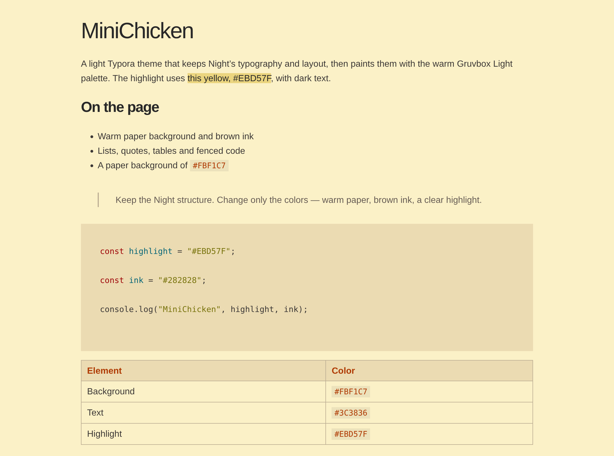

# MiniChicken for Typora

A light theme for [Typora](https://typora.io) that keeps the typography and layout of Typora's built-in **Night** theme and applies the warm [Gruvbox Light](https://github.com/morhetz/gruvbox) color palette.

Paper-colored background (`#FBF1C7`), brown text and accents, and a highlight of `#EBD57F`.

## Install

1. Download this repository and unzip it.
2. In Typora, open **Preferences → Appearance → Open Theme Folder**.
3. Copy `minichicken.css` and the `MiniChicken` folder into that folder, so the CSS imports (`MiniChicken/mermaid.css`, and so on) still resolve.
4. Restart Typora and choose **Minichicken** from the **Themes** menu.

Designed and tested on Windows. Not fully tested on macOS or Linux, but it should work there.

## Credits

- Layout, typography and CSS structure come from Typora's Night theme: [typora/typora-default-themes](https://github.com/typora/typora-default-themes).
- Colors come from the Gruvbox palette by [Pavel Pertsev (morhetz)](https://github.com/morhetz/gruvbox), MIT/X11.
- `MiniChicken/credit.html` keeps the original Night credit for Freepik icons from [Flaticon](https://www.flaticon.com/), [CC BY 3.0](https://creativecommons.org/licenses/by/3.0/).

MiniChicken is a separate theme from the [Gruvbox for Typora](https://theme.typora.io/theme/Gruvbox/) gallery entry by TwinklerG. That theme is its own adaptation of Gruvbox. MiniChicken starts from Night and only uses the Gruvbox Light colors.

## License

See [LICENSE](LICENSE) for the full notices, including the status of the Night theme sources.
